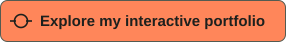
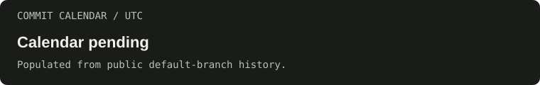

<picture>
  <source media="(prefers-color-scheme: dark)" srcset="assets/banner-dark.svg">
  
</picture>

I’m Yatharth, a student developer and designer in India. I build things I want to use, from a satellite pass finder to a desktop assistant that understands hand gestures. I’m learning how to make complex data feel natural to explore.

## Pick a project

<strong>Explore space</strong>

[OrbytMax](https://github.com/Yatharth10-bit/orbytmax-app) brings satellite passes, mission libraries, and orbit lessons together. [ORBITAL](https://github.com/Yatharth10-bit/Satellite-tracker) lets you follow individual satellites around a Three.js globe.

<strong>Look inside a prototype</strong>

[ClaimGuard](https://github.com/Yatharth10-bit/claimguard) puts product claims, review flags, and suggested rewrites in one workspace. [Ultron](https://yatharth10-bit.github.io/Yatharth-Portfolio/ultron.html) maps local speech and hand gestures to actions on a Windows desktop.

<strong>Try a small experiment</strong>

[After You](https://yatharth10-bit.github.io/Yatharth-Portfolio/afteryou.html) is a typewriter you can play with in your browser.

  

## On the workbench

<!-- signal:recent:start -->
The first activity snapshot will appear after the daily refresh. [Browse my public repositories](https://github.com/yatharth10-bit?tab=repositories).
<!-- signal:recent:end -->

[Email me](mailto:yatharthlegend252@gmail.com) · [Instagram](https://www.instagram.com/yatharthsrivastav_/) · [YouTube](https://www.youtube.com/@yatharthsrivastav10)

