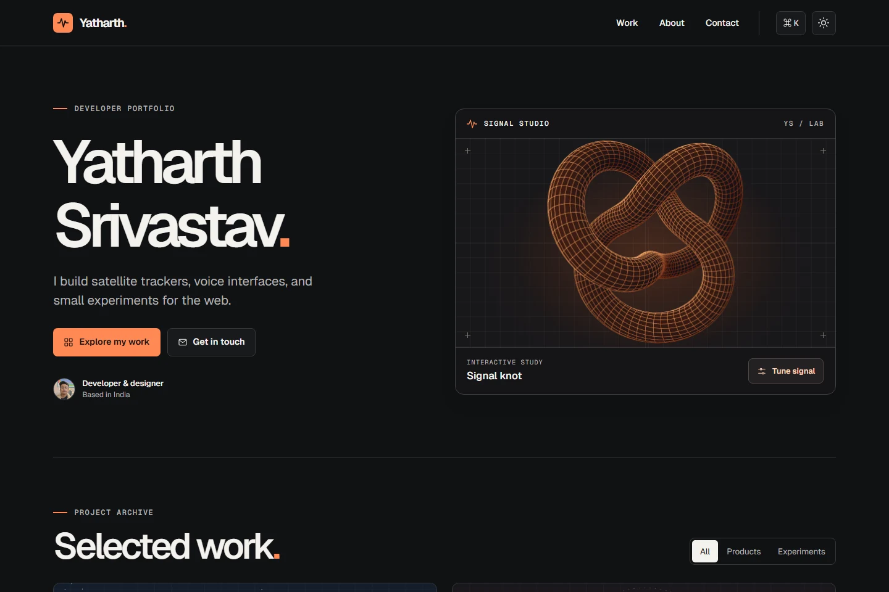

# Yatharth Srivastav · Yatharth’s Playroom

[Explore the interactive portfolio](https://yatharth10-bit.github.io/Yatharth-Portfolio/)



Five case studies connect satellite tracking, a local Windows voice assistant, compliance review, orbital visualization and a playful browser typewriter. Press **Ctrl/Cmd + K** to jump between them. Drag the toys, launch the astronaut, solve Star Courier, or print a note on the pocket typewriter.

## Run locally

Requires Node.js 22+. The production build uses Node's standard library, CSS and vanilla JavaScript.

```sh
npm run build
npm run check
npm run preview
```

Open `http://127.0.0.1:4173/Yatharth-Portfolio/`. Edit project descriptions in `src/data/portfolio.json`. Push a feature branch and open a pull request. Verified changes to main deploy via GitHub Actions.

[Development guide](docs/README-DEV.md) · [Source inventory](docs/RECON.md)

