<picture>
  <source media="(prefers-color-scheme: dark)" srcset="assets/banner-dark.svg">
  
</picture>

I’m a student developer and designer in India. I like building interfaces for things you usually can’t see. In **OrbytMax**, you can look up the next satellite pass over your city. In **Ultron**, a hand gesture becomes a desktop shortcut.

## Selected work

<strong>Two more projects to try</strong>

- [ClaimGuard](https://github.com/Yatharth10-bit/claimguard) brings product claims, regulatory updates and suggested rewrites into one review workspace.
- [After You](https://yatharth10-bit.github.io/Yatharth-Portfolio/afteryou.html#typewriter) is a browser typewriter. Move the carriage, write a note and print a snapshot.

## Activity in public

Recent repository activity

<!-- signal:recent:start -->
Public default branches · 44 authored commits · 1-day active streak · updated 2026-11-20 (UTC).

**Recently pushed projects**

- [Yatharth-Portfolio](https://github.com/Yatharth10-bit/Yatharth-Portfolio) · pushed 2026-11-20
- [claimguard](https://github.com/Yatharth10-bit/claimguard) · pushed 2026-11-19
- [Satellite-tracker](https://github.com/Yatharth10-bit/Satellite-tracker) · pushed 2026-11-19
- [orbytmax-app](https://github.com/Yatharth10-bit/orbytmax-app) · pushed 2026-11-19
<!-- signal:recent:end -->

[Email](mailto:yatharthlegend252@gmail.com) · [Instagram](https://www.instagram.com/yatharthsrivastav_/) · [YouTube](https://www.youtube.com/@yatharthsrivastav10)

